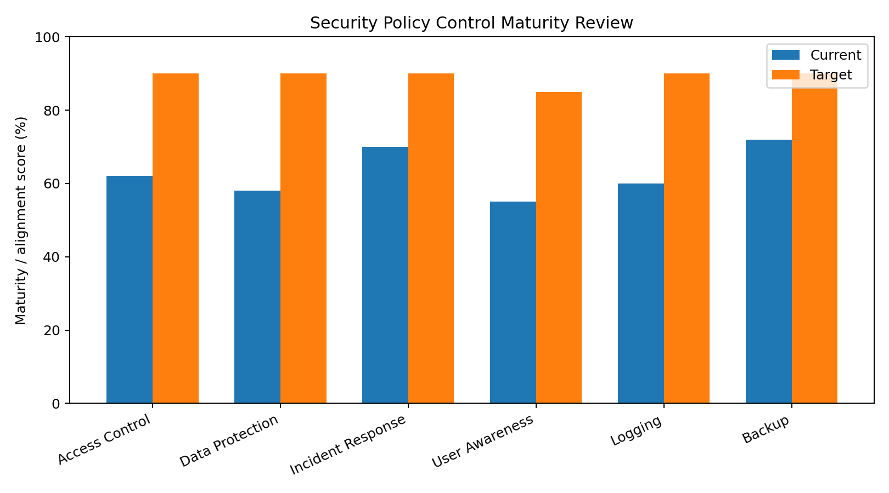
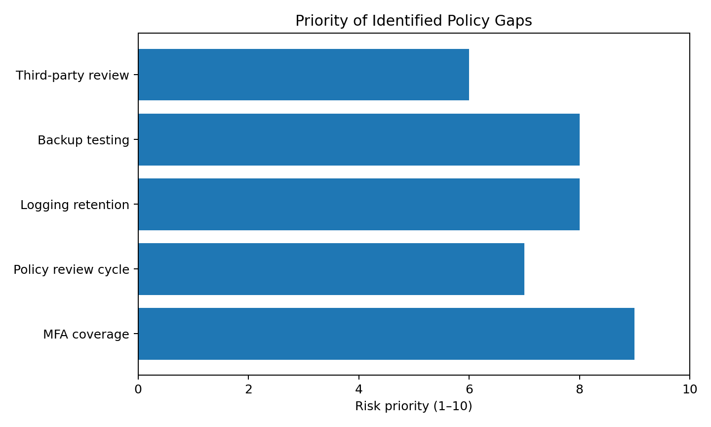

# Week 4 — Security Policy Review & Improvement Recommendations


> A defensive review of a hypothetical organization's security policy, with prioritized policy-gap observations and improvement recommendations.

## Executive Summary

This Week 4 assignment reviews a simulated organizational security policy across access control, data protection, incident response, awareness, logging, backup and recovery, third-party security, and policy governance.

The exercise identifies areas where policy language or governance could be strengthened and proposes practical improvements. It is an educational policy-review exercise, not a formal audit, certification, or assessment of a real organization.

## Contents

- [Objectives](#objectives)
- [Review scope](#review-scope)
- [Key findings](#key-findings)
- [Policy-gap analysis](#policy-gap-analysis)
- [Maturity assessment](#maturity-assessment)
- [Improvement recommendations](#improvement-recommendations)
- [Proposed review lifecycle](#proposed-review-lifecycle)
- [Repository contents](#repository-contents)
- [Frameworks and references](#frameworks-and-references)
- [Ethical and assessment limitations](#ethical-and-assessment-limitations)

## Objectives

- Review key domains in a hypothetical organizational security policy.
- Identify policy gaps and governance weaknesses.
- Prioritize findings according to the assessment.
- Recommend improvements for control ownership, implementation, and review.
- Consider policy maturity and continuous improvement.
- Reference established security frameworks and guidance.

## Review Scope

| Policy domain | Review focus |
|---|---|
| Access control and authentication | Account access, MFA, privileged and remote access |
| Data protection | Protection requirements for organizational information |
| Incident response | Roles, escalation, reporting, and response expectations |
| Security awareness | Defined training expectations and measurable completion |
| Logging and monitoring | Logging standards, retention, and review responsibilities |
| Backup and recovery | Backup protection and restoration testing |
| Third-party security | Supplier requirements and security responsibilities |
| Policy governance | Ownership, approval, review triggers, and exceptions |

## Key Findings

| Area | Simulated finding | Priority |
|---|---|---|
| MFA | Coverage should be expanded | Critical |
| Policy governance | Ownership and review triggers need clarity | High |
| Logging | Retention and monitoring standards need definition | High |
| Backup | Restoration testing should be formalized | High |
| Awareness | Measurable training targets are needed | Medium |
| Third parties | Security clauses should be strengthened | Medium |

### Assessment visuals





## Policy-Gap Analysis

The findings can be translated into improvement questions and evidence to request during a future authorized review.

| Finding | Review question | Suggested evidence |
|---|---|---|
| MFA coverage | Which user groups and access paths require MFA? | Authentication policy, coverage report, exception register |
| Policy governance | Who owns each policy and what triggers review? | Policy owner list, approval history, review schedule |
| Logging | Which events are logged, retained, and reviewed? | Logging standard, retention schedule, monitoring responsibilities |
| Backup | Are restore tests defined and recorded? | Backup standard, test records, recovery procedures |
| Awareness | Are training expectations measurable? | Training plan, completion reports, awareness metrics |
| Third-party security | Are supplier security requirements documented? | Supplier clauses, due-diligence records, review process |

The evidence column is a suggested review aid, not evidence that these records were collected from a real organization.

## Maturity Assessment

The project report includes a **simulated maturity assessment** and a prioritized policy-gap analysis. Refer to the report for the exercise's assessment detail.

Maturity observations should be interpreted as a way to identify improvement opportunities, not as a certified maturity rating. A real assessment would require defined criteria, documented evidence, stakeholder validation, and an agreed assessment scope.

## Improvement Recommendations

| Priority | Recommended improvement | Expected policy outcome |
|---|---|---|
| Critical | Expand MFA requirements for privileged and remote access | Clearer authentication requirements |
| High | Assign policy owners and define review triggers | Accountable policy governance |
| High | Define logging, retention, and monitoring requirements | More consistent security visibility |
| High | Formalize backup restoration testing | Clearer recovery assurance |
| Medium | Set measurable security-awareness targets | Trackable awareness expectations |
| Medium | Strengthen third-party security clauses | More explicit supplier responsibilities |
| Supporting | Document policy-exception management | Consistent approval and review of exceptions |

### Suggested implementation sequence

1. Address the critical MFA coverage gap.
2. Assign owners and approval responsibilities to the relevant policies.
3. Define logging and backup requirements, including evidence of review and testing.
4. Set measurable awareness expectations.
5. Strengthen supplier security wording and the exception-management process.
6. Reassess the policy after changes and record remaining gaps.

This sequence is a recommendation derived from the priorities shown in the exercise; it is not a statement that the actions have already been implemented.

## Proposed Policy Review Lifecycle

**Define scope and owners → collect policy documents → review requirements and evidence → record gaps and priorities → approve improvement actions → track remediation → schedule the next review.**

## Repository Contents

```text
week-4-security-policy-review/
├── README.md
├── report/
│   └── Week_4_Security_Policy_Review_Evaluation_and_Improvement_Recommendations_2026.docx
├── charts/
│   ├── policy-maturity-review.png
│   └── policy-gap-priority.png
└── references/
    └── sources.md
```

- **Report:** detailed policy-review exercise and recommendations.
- **Charts:** simulated maturity and policy-gap priority visuals.
- **References:** security-framework and standard links used for context.

## Frameworks and References

The assignment references:

- NIST Cybersecurity Framework (CSF) 2.0
- NIST SP 800-53 Rev. 5 — Security and Privacy Controls
- ISO/IEC 27000 family, including ISO/IEC 27001:2022

See [references/sources.md](references/sources.md) for direct source links.

Framework references provide context for the review. This assignment does **not** claim that an organization was formally assessed against every control, is compliant, or holds an ISO certification.

## Learning Outcomes

- Reviewing policy coverage across common security-governance domains.
- Identifying policy gaps and assigning improvement priorities.
- Connecting policy statements to ownership and evidence.
- Developing practical governance and review recommendations.
- Understanding the difference between an educational gap review and a formal audit or certification.

## Ethical and Assessment Limitations

This is a **hypothetical, educational, and defensive policy-review exercise**. It does not assess a real organization's confidential policies, establish regulatory compliance, provide legal advice, or confer certification. A formal assessment requires an agreed scope, documented criteria, reliable evidence, and appropriate authorization.

---

**Author:** Injmam Ansari  
BCA Student | Cyber Security Analyst Intern

*Week 4 internship documentation — Security Policy Review & Improvement Recommendations.*
